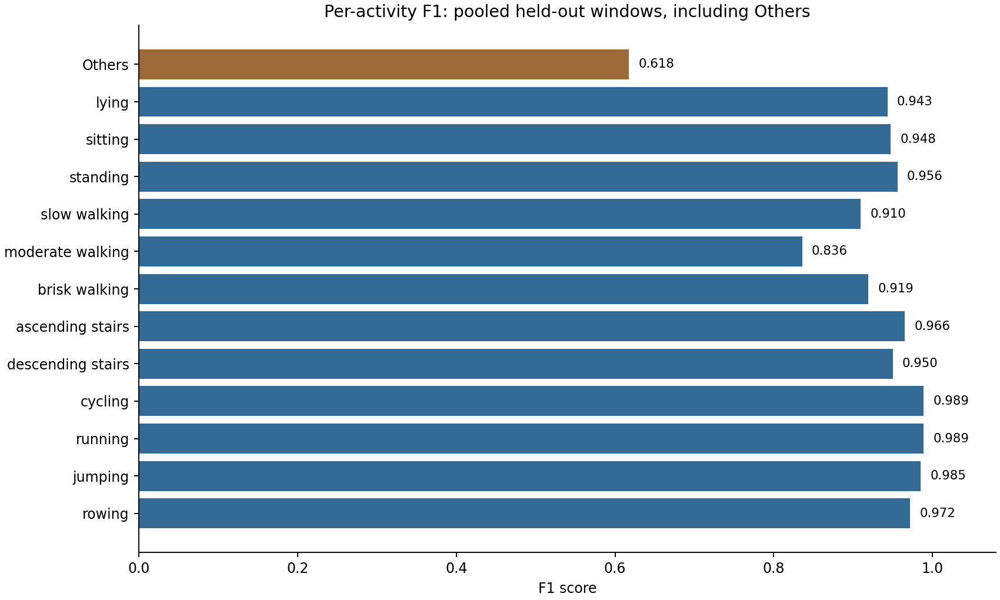
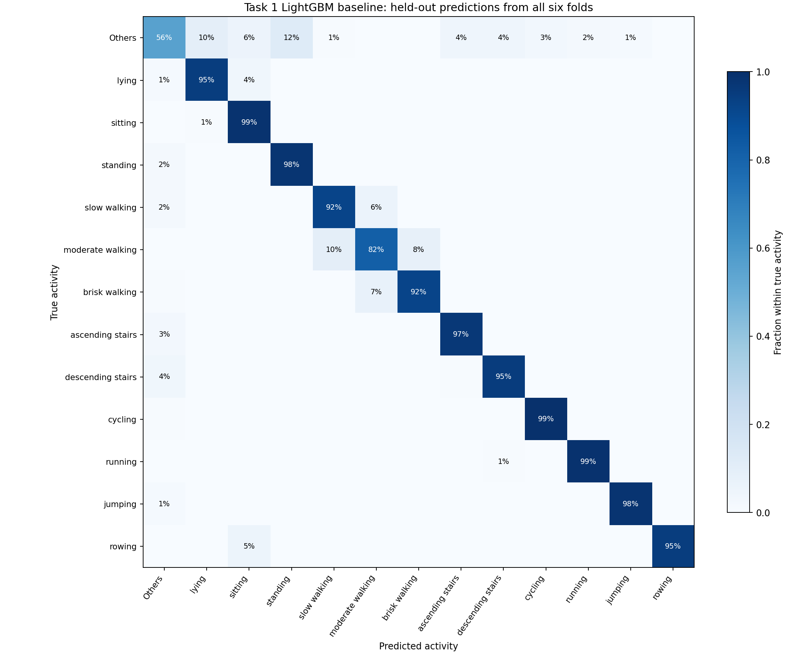
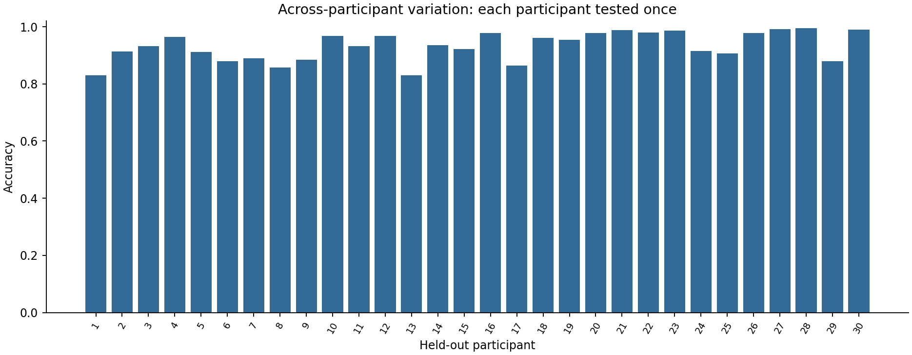

# Task 1 LightGBM六折基线测试

完成时间：2026年11月27日23时13分，北京时间。运行版本：`task1_lightgbm_baseline_v1`。

## 测试结果

| 指标 | 合并外层测试结果 |
|---|---:|
| 13类Macro-F1 主指标 | 0.921536 |
| 准确率 | 0.933467 |
| 12个命名活动Macro-F1 全部窗口包含Others误报 | 0.946854 |
| 12个命名活动Macro-F1 仅真实非Others窗口 | 0.956664 |
| 三档步行Macro-F1 全部测试窗 | 0.888239 |
| 六折13类Macro-F1均值 | 0.920599 |
| 六折13类Macro-F1标准差 | 0.032460 |

13类Macro-F1的参与者聚类bootstrap 95%区间为 `[0.902854, 0.938091]`。区间以已训练六个模型为条件，不包含重新训练的不确定性；折间标准差作描述使用。

## 协议与防泄漏

- 30人、220,702个2秒窗，每传感器40项固定特征，共680项；保留13类与所有窗口纯度。
- 使用底座中已保存的参与者六折划分：每折20人训练、5人验证、5人测试，属于固定内部验证方案。
- 固定LightGBM参数，最多300轮；仅按验证参与者的13类Macro-F1早停40轮，没有超参数搜索。
- 不做全体标准化、插补或预测平滑，主频NaN由LightGBM原生处理。
- 训练和早停结束后才加载该折测试特征，测试预测只执行一次。30人各测试一次，所有窗口恰好覆盖且无重复。

## 逐折表现

| 折 | 13类Macro-F1 | 准确率 | 最佳迭代轮次 |
|---|---:|---:|---:|
| 0 | 0.866542 | 0.880633 | 224 |
| 1 | 0.922982 | 0.931540 | 295 |
| 2 | 0.930926 | 0.942539 | 268 |
| 3 | 0.964550 | 0.977407 | 91 |
| 4 | 0.907079 | 0.914871 | 52 |
| 5 | 0.931515 | 0.944558 | 78 |

## 主要误差

Others的F1为0.617719，中速步行为0.835872，慢走为0.909694，快走为0.919150。Others经常被判成躺卧、坐和站；中速步行主要与慢走及快走混淆。

稳定窗口（纯度至少0.90）准确率为93.75%；低纯度过渡窗口为80.32%。分组13类Macro-F1固定包含13类，类别覆盖不足时会受影响，应同时阅读准确率和逐类支持数。

## 使用与比较边界

这是独立LightGBM基线，不是队友CNN的同实现复现。队友报告的12类分数与本轮主指标口径不同，不能直接据此宣称方法更优。原始加速度未额外换算单位、去重力或重复旋转，已有单位分歧仍待核对。

后续改进应通过训练与验证参与者选型；若根据本轮外层测试反复选方法，需要据实说明评估复用，不能继续视为完全独立最终评估。

## 文件入口

- [完整指标图表与报告包](../results/task1/lightgbm_baseline_v1/README.md)
- [训练与汇总脚本](../scripts/task1/README.md)
- [更新前文档归档](archive/2026-11-27_before_task1_baseline/README.md)

下一步优先核对Others与步行混淆，再确定验证集上的改进方案，并衔接Task 2布局实验。
