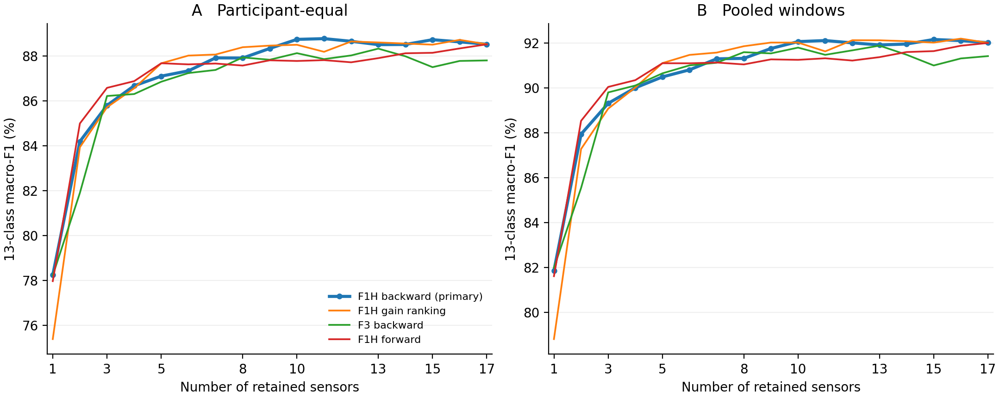

# 第二问 V4 传感器精简实验报告

第二问于 **2026年11月28日 22:04:59（北京时间）** 完成四组六折实验，共 **2,856 次训练**。F1H 逐个拆的主实验从全 17 个减到 **8 个**时，合并 13 类 Macro-F1 从 **92.01%** 降到 **91.31%**，相差 **0.70 个百分点**。对于以减轻佩戴负担为目标的原型，建议先在 **下背（L5）、右小腿、上背、右足** 各放 1 个传感器，然后对这一固定布局做复验。

## 实验方法

使用 30 名参与者的 2 秒窗口，共 220,702 个，每个窗口完全位于一个试次内。固定六折，每折 20 人训练、5 人验证、5 人测试，整单元移除后，只从保留单元读取特征。F1H 使用各传感器的水平模长和垂直惯性分量，F3 使用世界系惯性特征和自身姿态。四组统一使用 LightGBM 4.6.0 CUDA，模型最多 80 轮，早停依据验证集。指标使用 LightGBM 的直接预测。

主实验从全布局逐个试拆，每一步用验证人员的被试等权 13 类 Macro-F1 选布局，得分相同时比较合并 Macro-F1，剩余同分按固定传感器顺序处理。每折 1 到 17 个传感器的布局全部锁定后，才对该折留出人员评估。本轮每个受试者在每种配置下恰好作为测试对象一次。被试等权先对每个人分别计算 F1 再平均，合并窗口先汇总混淆矩阵再计算 F1。

## 数量与性能

| 保留传感器 | 被试等权 13 类 Macro-F1 | 合并 13 类 Macro-F1 | 合并变化（百分点） | 变化的 95% 区间（百分点） |
|---:|---:|---:|---:|---:|
| 17 | 88.53% | 92.01% | +0.00 | [+0.00, +0.00] |
| 10 | 88.75% | 92.06% | +0.05 | [-0.49, +0.60] |
| 8 | 87.91% | 91.31% | -0.70 | [-1.52, +0.09] |
| 6 | 87.34% | 90.80% | -1.21 | [-2.16, -0.31] |
| 5 | 87.11% | 90.49% | -1.52 | [-2.50, -0.64] |
| 4 | 86.68% | 90.00% | -2.01 | [-2.96, -1.11] |
| 3 | 85.81% | 89.31% | -2.70 | [-4.04, -1.42] |
| 1 | 78.25% | 81.86% | -10.15 | [-12.16, -8.04] |

表中每个数量对应六折各自选定的布局。区间按 30 名测试参与者做 3,000 次配对重抽样，模型固定，反映这些人对当前评估结果的影响。10 个与 17 个的区间覆盖零，这里把两者视为本轮结果接近。该区间未包含重新训练或重新选点的变异。

## 三组对照

下表按合并 13 类 Macro-F1 汇报，计时列是候选训练及其验证评分的日志累计时间。完整运行从 13:37:58 到 22:04:59，约 8 小时 27 分钟。

| 方法 | 17 个 | 10 个 | 8 个 | 5 个 | 4 个 | 训练次数 | 累计分钟 |
|---|---:|---:|---:|---:|---:|---:|---:|
| F1H 重要性排序 | 92.00% | 92.01% | 91.85% | 91.10% | 90.02% | 102 | 16.7 |
| F1H 逐个拆（主实验） | 92.01% | 92.06% | 91.31% | 90.49% | 90.00% | 918 | 160.7 |
| F3 逐个拆 | 91.41% | 91.79% | 91.59% | 90.65% | 90.10% | 918 | 201.0 |
| F1H 逐个加 | 92.00% | 91.25% | 91.04% | 91.10% | 90.34% | 918 | 124.4 |

重要性排序用 102 次训练获得了与主实验接近的总体表现，但不同数量下的相对排名会变。换成 F3 或从零逐个加，也会改变曲线。这表明性能同时取决于保留多少位置、保留哪些位置和用什么特征。各组的 17 个基准应结合自身特征解释。

## 推荐位置和适用范围

为形成可试戴的轻量原型，我们在结果整理阶段采用 **1 个百分点的验证集损失预算**，并用 0.5 和 2 个百分点检验预算敏感性。每折在自己的验证数据上，选取相对同折 17 个传感器等权分数下降不超过预算的最小数量，再汇总已保存的该折测试预测。

| 验证预算（百分点） | 六折所选数量 | 数量中位数 | 留出被试等权 Macro-F1 | 留出合并 Macro-F1 |
|---:|---|---:|---:|---:|
| 0.5 | 4 / 4 / 4 / 3 / 4 / 6 | 4 | 86.31% | 89.72% |
| 1.0 | 3 / 4 / 3 / 3 / 4 / 5 | 3.5 | 85.84% | 89.34% |
| 2.0 | 3 / 2 / 3 / 3 / 3 / 3 | 3 | 85.97% | 89.39% |

1 个百分点方案所选数量为 3 至 5 个，留出合并分数较全布局变化 **-2.67 个百分点**。验证预算只负责折内选点，留出数据给出了对新参与者的实际损失。若业务重视坐姿、躺卧等易退化的动作，或要求接近全布局的表现，可以优先验证 8 至 10 个的配置。主实验 8、10 个的曲线提供了性能对照。

固定 4 点原型取该方案数量中位数向上取整，再按主实验 4 点布局的六折入选频率排序，同票依次看较小布局中的持续入选情况和固定传感器顺序。入选次数为 **下背（L5） 5/6，右小腿 3/6，上背 3/6，右足 3/6**。六折布局两两的平均交并比为 **0.257**，说明下背较稳定，其他位置有替代可能。上述固定四点是合成推荐，表中的四点成绩来自各折各自选出的布局。固定布局的性能待另行验证。

从动作信息看，下背和上背分别提供骨盆附近与上躯干的运动信息，小腿和足部则能提供摆动与迈步节律。主实验在保留 5 个时，下背入选 6/6 折，左足入选 5/6 折。结合 4 点布局的左右足入选情况，左右测点可作为替代候选，替代效果仍与活动类型有关。此处的功能解释来自佩戴位置和入选规律，尚未做定点交换实验。

4 点折内布局相对 17 点，合并类别 F1 下降最多的是 **坐姿（-5.10 个百分点）、其他（Others）（-4.63 个百分点）、躺卧（-3.53 个百分点）**。部署时应优先复查静态姿态和过渡片段。现场需固定每个传感器的佩戴位置和朝向，维持时间同步，并保持与数据一致的竖直轴与单位约定。F1H 的水平模长对绕竖直轴的航向变化不敏感。现场设备若提供不同坐标约定的原始信号，应先核对安装方向和竖直轴，复验后再使用。

## 结果核验与第三问交接

从云端逐窗口预测重算了 4 组 × 17 个数量的被试等权 F1、合并 F1 和准确率，均与原始汇总一致。按折确认了训练、验证和测试人员互斥，并逐一核对不同数量下的测试窗口坐标和标签。公开结果包含数量曲线、逐类汇总、逐折排名和逐折布局，逐人指标及逐窗口预测保留在云端。

第三问使用 **同一折** 的 [F1H 逐个拆布局清单](../results/task2_v4/run_20261128_full/F1H_backward/per_fold_selected_subsets.json)，在各折留出数据上比较精简布局的重建表现。云端完整结果目录为 `/root/autodl-tmp/C_Problem/results/task2_v4_20261128`。可复现配置、源代码差异和文件校验见 [结果目录](../results/task2_v4/run_20261128_full/README.md)。
